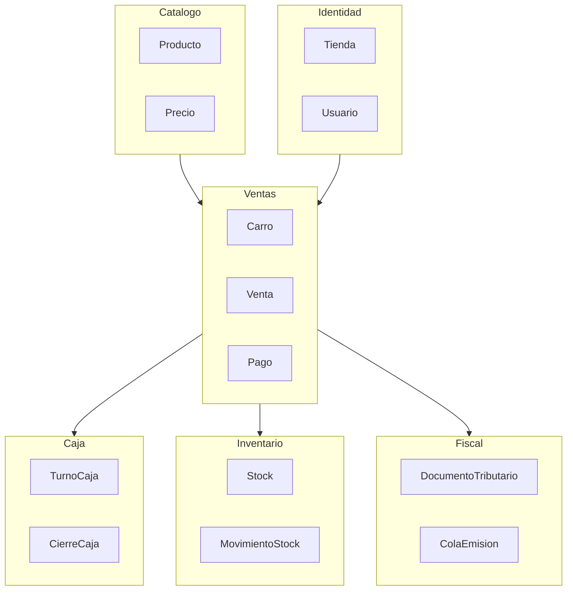

# 03 — Dominio y glosario

## Bounded contexts (v1)

## Glosario

| Término | Definición |
|---------|------------|
| **Tienda** | Unidad comercial con RUT, certificado SII y configuración local |
| **Producto en tienda** | SKU vendible en esa tienda (precio, costo, barcode opcional) |
| **Carro** | Venta en curso, no persistida como venta cerrada |
| **Venta** | Transacción confirmada con líneas, totales y pagos |
| **Turno de caja** | Intervalo entre apertura y cierre con saldo inicial |
| **Medio de pago** | Efectivo, transferencia, débito, crédito (integración posterior) |
| **DTE** | Documento tributario electrónico (MVP: boleta afecta/exenta) |
| **Cola DTE** | Ventas emitidas offline o fallidas pendientes de envío SII |
| **Merma** | Salida de stock no asociada a venta (ajuste negativo) |
| **Fiado** | Venta a crédito simple con saldo cliente (fase 1.5) |

## Invariantes de dominio (resumen)

| ID | Regla |
|----|--------|
| INV-01 | No se puede cerrar venta sin al menos un ítem con cantidad &gt; 0 |
| INV-02 | Total venta = suma líneas con impuestos según configuración tienda |
| INV-03 | Al confirmar venta con stock habilitado, cantidad vendida descuenta stock |
| INV-04 | No vender por encima de stock si `bloquearSinStock = true` |
| INV-05 | Boleta emitida lleva folio/timbre o estado `PENDIENTE_SII` explícito |
| INV-06 | Cierre de caja requiere turno abierto y usuario con rol autorizado |
| INV-07 | Cajero no puede modificar costo ni eliminar historial de ventas |

## Eventos de dominio (para slices)

- `ProductoCreado`, `StockAjustado`, `VentaConfirmada`, `DteEmitido`, `DteFallido`, `TurnoAbierto`, `CierreCajaRealizado`