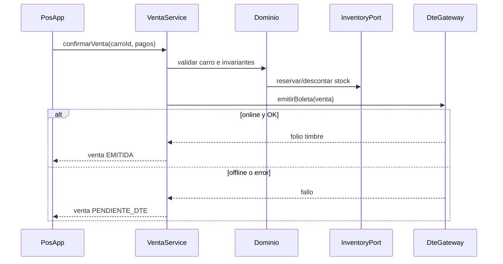

# 06 — Arquitectura

## Estilo

**Modular monolith** local-first, preparado para sync posterior.

```
atria_pos/
├── apps/
│   └── pos_app/              # Flutter UI
├── packages/
│   ├── core/                 # Dominio + casos de uso (TDD principal)
│   ├── core_test/            # Tests de comportamiento (opcional mismo package)
│   └── adapters/             # SQLite, DTE mock/SII, barcode
├── docs/
└── test/
    └── acceptance/           # Escenarios API / e2e ligeros
```

## Capas (`packages/core`)

| Capa | Contenido | Dependencias |
|------|-----------|--------------|
| **domain** | Entidades, value objects, invariantes | Ninguna |
| **application** | Casos de uso, puertos (interfaces) | domain |
| **api** | DTOs request/response, mapeo errores | application |

Los **adaptadores** implementan puertos: `ProductRepository`, `SaleRepository`, `DteGateway`, `Clock`, `IdGenerator`.

## Flujo venta (secuencia)



## Puertos críticos (test doubles en TDD)

```dart
// Referencia conceptual — no es código productivo aún
abstract class DteGateway {
  Future<DteResult> emitirBoleta(BoletaRequest request);
}

abstract class ProductRepository {
  Future<Product?> findByBarcode(Barcode code, StoreId store);
  Future<List<Product>> search(String query, StoreId store);
}
```

## Persistencia

- **MVP:** SQLite por dispositivo, una tienda por instalación (multi-tienda = fase 2).
- Migraciones versionadas (`schema_version`).

## Integración SII

| Fase | Implementación |
|------|----------------|
| Slice 1–4 | `FakeDteGateway` (determinista) |
| Slice 5 | `CertificationDteGateway` (ambiente cert SII) |
| Producción | Tras UAT con cliente piloto |

Emisión **núcleo**: siempre vía `DteGateway` del POS. Kora puede ofrecer DTE como **complemento** para otros canales; no reemplaza el núcleo sin configuración explícita (doc `14`).

## Complementos opcionales (Kora)

| Tipo | Puerto | Obligatorio |
|------|--------|-------------|
| Núcleo | `DteGateway`, repos venta/inventario/caja | Sí (con fake en tests) |
| Complemento | `CrmSyncPort`, `CatalogComplementPort`, … | No; `NoOp` si `kora.enabled=false` |

Detalle de reglas R-K1…R-K6 en `14-nucleo-y-complementos-kora.md`.

## Decisiones pendientes (Gate 1)

| Tema | Opciones |
|------|----------|
| Backend sync | Ninguno en MVP vs Dart Frog minimal |
| ORM | drift vs sqflite raw |
| Auth multi-dispositivo | Postergar |