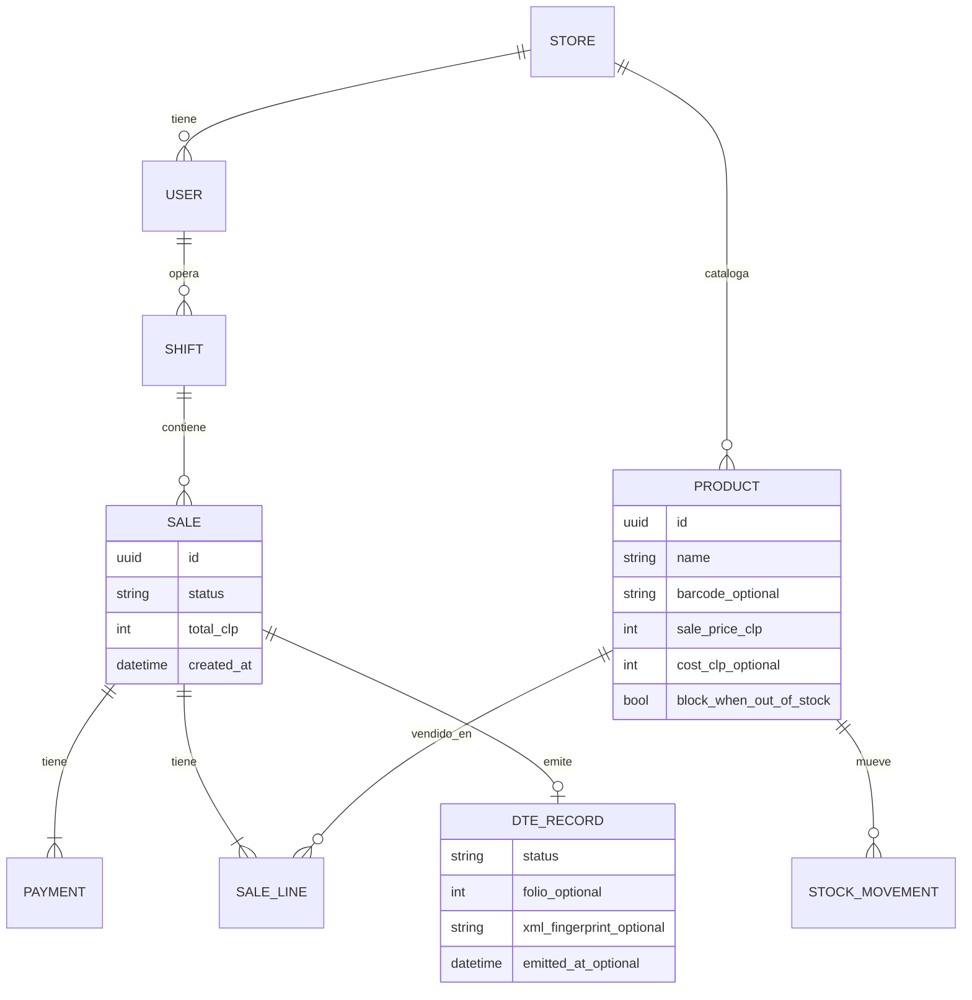

# 08 — Modelo de datos conceptual

Entidades lógicas (no es DDL final).

## Diagrama ER

## Tablas / agregados

### `stores`

| Campo | Tipo | Notas |
|-------|------|-------|
| id | UUID | |
| rut | string | validación módulo 11 |
| legal_name | string | |
| tax_config | JSON | afecta/exenta default |

### `users`

| Campo | Tipo |
|-------|------|
| id | UUID |
| store_id | FK |
| name | string |
| role | enum |
| pin_hash | string |

### `products`

Índice: `(store_id, barcode)`, full-text `name`.

### `stock_levels`

`product_id`, `quantity` (decimal permitido para pesables — fase 2).

### `stock_movements`

`type`: `VENTA` | `AJUSTE` | `MERMA` | `ANULACION`; `reference_id` (sale_id).

### `carts`

Ephemeral o persisted hasta checkout; `shift_id`, `user_id`.

### `sales`

`shift_id`, `user_id`, `status`: `CONFIRMADA` | `ANULADA`.

### `dte_records`

` sale_id` unique; cola: `PENDING` | `SENT` | `FAILED`.

### `shifts`

`opened_at`, `closed_at`, `opening_cash_clp`, `closing_counted_cash_clp`.

## Política stock vs DTE (decisión requerida)

| Opción | Comportamiento |
|--------|----------------|
| **A (operación primero)** | Descuenta stock al checkout; DTE puede quedar pendiente |
| **B (fiscal estricto)** | Stock y venta “cerrada” solo tras DTE exitoso |

**Decisión Gate 1:** Opción **A** — descontar stock al checkout; DTE puede quedar `PENDIENTE_DTE` con cola de reintento.