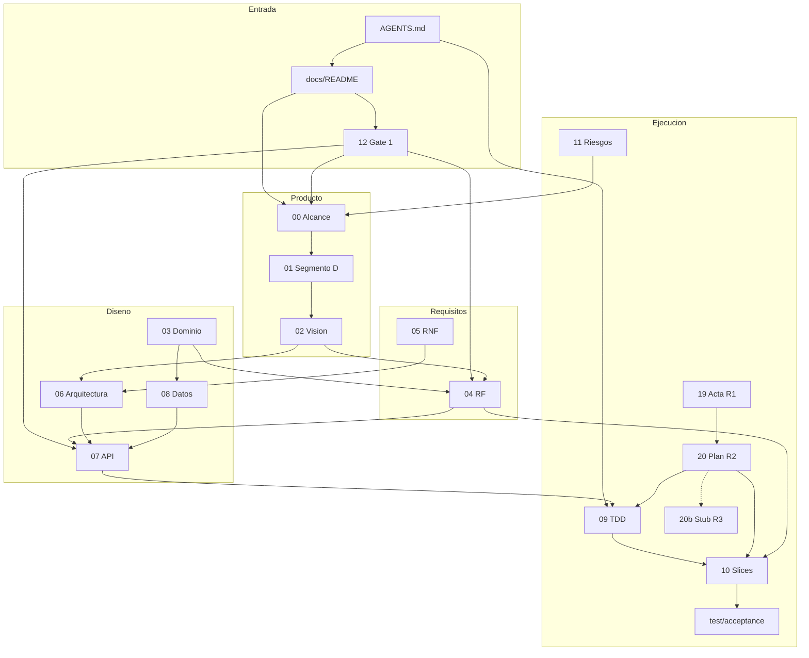

# 13 — Mapeo de documentación (Markdown)

Inventario y relaciones entre todos los archivos `.md` del repositorio. **Actualizar** al agregar RF, slices o contratos.

## Inventario (25+ archivos + carpeta `decisiones/`)

| Archivo | Tipo | Rol |
|---------|------|-----|
| [`AGENTS.md`](../AGENTS.md) | Operativo | Instrucciones para agentes IA (gates, TDD, comandos) |
| [`docs/README.md`](README.md) | Índice | Punto de entrada humana |
| [`docs/00-contexto-y-alcance.md`](00-contexto-y-alcance.md) | Producto | Problema, usuarios, MVP in/out, éxito |
| [`docs/01-perfil-segmento-d.md`](01-perfil-segmento-d.md) | Producto | JTBD, benchmark segmento D |
| [`docs/02-vision-y-principios.md`](02-vision-y-principios.md) | Producto | Visión, principios UX/técnicos, stack propuesto |
| [`docs/03-dominio-y-glosario.md`](03-dominio-y-glosario.md) | Dominio | Bounded contexts, glosario, INV-0x, eventos |
| [`docs/04-requisitos-funcionales.md`](04-requisitos-funcionales.md) | Requisitos | RF-001…070 (M/S/C) + criterios Dado/Cuando/Entonces |
| [`docs/05-requisitos-no-funcionales.md`](05-requisitos-no-funcionales.md) | Requisitos | RNF rendimiento, offline, seguridad, cobertura |
| [`docs/06-arquitectura.md`](06-arquitectura.md) | Técnico | Capas, puertos, diagrama venta, SQLite, SII por fases |
| [`docs/07-contratos-api-publica.md`](07-contratos-api-publica.md) | Contrato | API-001…006, errores, matriz RF↔API |
| [`docs/08-modelo-datos-conceptual.md`](08-modelo-datos-conceptual.md) | Técnico | ER, tablas, política stock+DTE (Gate 1: opción A) |
| [`docs/09-estrategia-tdd.md`](09-estrategia-tdd.md) | Proceso | Ciclo vertical, pirámide tests, fakes, DoD test |
| [`docs/10-plan-entregas.md`](10-plan-entregas.md) | Proceso | SLICE-0…9, orden semanal, branching |
| [`docs/11-riesgos-y-supuestos.md`](11-riesgos-y-supuestos.md) | Gestión | S-0x, R-0x, deuda aceptada |
| [`docs/12-cierre-gate-1.md`](12-cierre-gate-1.md) | Gate | Confirmación alcance + decisiones D1–D6 ✅ |
| [`docs/14-nucleo-y-complementos-kora.md`](14-nucleo-y-complementos-kora.md) | Integración | Núcleo autónomo; Kora complemento opcional |
| [`docs/15-plan-definicion-pre-implementacion.md`](15-plan-definicion-pre-implementacion.md) | Proceso | Plan extenso Gate 2, fases 0–7 |
| [`docs/16-registro-decisiones.md`](16-registro-decisiones.md) | Proceso | DEC-001…040 |
| [`docs/17-cierre-gate-2.md`](17-cierre-gate-2.md) | Gate | Autoriza SLICE-1+ |
| [`docs/19-revision-progreso-20251120.md`](19-revision-progreso-20251120.md) | Acta | Cierre revisión 1; handoff §11 → doc 20 |
| [`docs/20-plan-revision-2-atria-pos.md`](20-plan-revision-2-atria-pos.md) | Proceso | Plan revisión 2; Gate R2; R2-A/R2-B |
| [`docs/20b-esbozo-revision-3.md`](20b-esbozo-revision-3.md) | Proceso | Stub R3 SII/Kora (fuera R2) |
| [`docs/08b-esquema-sqlite-v1.md`](08b-esquema-sqlite-v1.md) | Técnico | DDL borrador |
| [`docs/decisiones/README.md`](decisiones/README.md) | Proceso | Plantilla ADR |
| [`test/acceptance/README.md`](../test/acceptance/README.md) | Tests | Convención escenarios Gherkin por slice |

**Relacionado (no Markdown):** [`.cursor/rules/pos-segmento-d.mdc`](../.cursor/rules/pos-segmento-d.mdc) — reglas Cursor (resumen de gates + docs).

---

## Grafo de dependencias (lectura)

---

## Flujo por rol

| Rol | Secuencia recomendada |
|-----|------------------------|
| **Producto / dueño** | 00 → 01 → 04 (solo [M]) → 12 |
| **Dev nuevo** | README → 12 → 03 → 06 → 07 → 09 → 10 → slice activo |
| **QA / TDD** | 04 + 07 → `test/acceptance` → 09 |
| **IA (Cursor)** | AGENTS → regla `.mdc` → slice en 10 |

---

## Mapeo RF → API → Slice

| RF [M] | API | SLICE (doc 10) | Bounded context (doc 03) |
|--------|-----|----------------|---------------------------|
| RF-010, RF-011 | API-001 | SLICE-1 | Catálogo |
| RF-020, RF-021 | API-004 | SLICE-2 | Inventario |
| RF-030, RF-031 | API-002 | SLICE-3 | Ventas |
| RF-040, RF-041 | API-003 | SLICE-4 | Caja |
| RF-050, RF-051 | API-005 (+002 checkout) | SLICE-5 | Fiscal |
| RF-002 | API-006 | SLICE-7 | Identidad |
| RF-001, RF-003 | API-001 + DTE | SLICE-8 | Identidad / Fiscal |
| UI venta | — | SLICE-6 | — |
| RF-001…070 (consolidación) | — | SLICE-0 | — |

RF [S] y [C] no bloquean MVP; ver tabla completa en doc 04.

---

## Mapeo IDs entre documentos

| Prefijo | Definido en | Consumido en |
|---------|-------------|--------------|
| `RF-xxx` | 04 | 07, 10, 09, acceptance tests |
| `RNF-xxx` | 05 | 09, 06 |
| `INV-xx` | 03 | 04, tests dominio |
| `API-xxx` | 07 | 09, acceptance |
| `SLICE-x` | 10 | AGENTS, 09, acceptance |
| `S-xx`, `R-xx` | 11 | 00, 12 |
| `D1–D6` | 12 | 08, 07, 02 |

---

## Contratos API (resumen doc 07)

| ID | Dominio | Operaciones clave |
|----|---------|-------------------|
| API-001 | Productos | CRUD/búsqueda |
| API-002 | Ventas | Carro, líneas, checkout |
| API-003 | Caja | Abrir/cerrar turno |
| API-004 | Inventario | Ajustes, merma |
| API-005 | Fiscal | Cola DTE, reintento |
| API-006 | Auth | Login local PIN |

Códigos error: `VALIDACION`, `STOCK_INSUFICIENTE`, `TURNO_CERRADO`, `PENDIENTE_DTE`, etc.

---

## Estado Gate y decisiones (doc 12)

| Decisión | Valor confirmado |
|----------|----------------|
| D1 Stack | Flutter + `packages/core` |
| D2 Backend | Solo SQLite local |
| D3 Stock vs DTE | Opción A (descontar + pendiente) |
| D5 Fiado | Post-MVP |
| D6 Tests | Escenarios en español |

---

## Huecos / pendientes documentales

| Ítem | Ubicación esperada | Estado |
|------|-------------------|--------|
| `slice_01_catalogo.md` | `test/acceptance/` | Por crear (SLICE-1) |
| `docs/CHANGELOG.md` | docs | Por crear (SLICE-0) |
| Matriz RF↔pantallas UI | nuevo o anexo 04 | No existe |
| OpenAPI machine-readable | export desde 07 | No existe |

---

## Mantenimiento

Al cambiar un **contrato** (doc 07): actualizar 08 si afecta datos, 10 si cambia slice, y escenario en `test/acceptance`.

Al cerrar **Gate** nuevo (release mayor): duplicar sección en doc 12 o crear `12b-gate-2.md`.