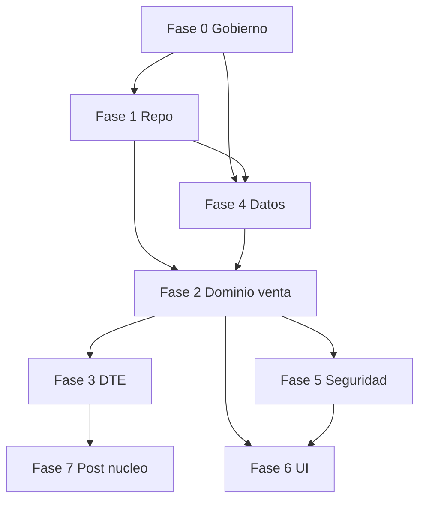

# 15 — Plan extenso de definición pre-implementación (Gate 2)

**Objetivo:** cerrar **todas** las decisiones técnicas y de producto que hoy están abiertas o solo esbozadas, **antes** de escribir lógica de negocio (antes de SLICE-1 en serio; SLICE-0 scaffold permitido si no fija decisiones).

**Prerrequisito:** Gate 1 cerrado ([`12-cierre-gate-1.md`](12-cierre-gate-1.md)).

**Entrega de Gate 2:** checklist [`16-registro-decisiones.md`](16-registro-decisiones.md) completo en ítems **bloqueantes MVP** + documentos derivados actualizados.

---

## 1. Cómo usar este plan

### 1.1 Ciclo por ítem pendiente

```text
Descubrir → Opciones → Decidir → Documentar → Revisar → Marcar DEC-xxx ✅
```

| Paso | Artefacto |
|------|-----------|
| Opciones | Breve tabla en ADR [`decisiones/DEC-xxx-slug.md`](decisiones/README.md) |
| Decisión | Campo en [`16-registro-decisiones.md`](16-registro-decisiones.md) |
| Impacto | Actualizar 04 / 05 / 06 / 07 / 08 según corresponda |
| Tests | Anotar escenario futuro en `test/acceptance` si cambia comportamiento |

### 1.2 Prioridades

| Prioridad | Significado | Cuándo cerrar |
|-----------|-------------|---------------|
| **P0** | Bloquea SLICE-1 o contradice núcleo | Antes de SLICE-1 |
| **P1** | Bloquea SLICE-5–8 (DTE, caja, roles) | Antes de ese slice |
| **P2** | Post-MVP núcleo (pagos, complementos) | Antes de slice indicado |
| **P3** | Mejora / escala | Backlog |

### 1.3 Roles sugeridos

| Rol | Responsabilidad |
|-----|-----------------|
| **Producto** | RF, UX mostrador, qué es núcleo vs complemento |
| **Arquitectura** | Capas, puertos, transacciones, sync |
| **Fiscal** | SII, DTE, certificados, cola offline |
| **QA** | Aceptación, cobertura, datos de prueba |
| **Ops** | Despliegue, backup, actualizaciones en tienda |

---

## 2. Fases del plan de definición

### Fase 0 — Inventario y gobierno (1–2 días)

| ID | Actividad | Entregable | P |
|----|-----------|------------|---|
| F0-1 | Revisar lista maestra DEC en doc 16 | 100 % ítems con dueño y prioridad | P0 |
| F0-2 | Acordar convención ADR | [`decisiones/README.md`](decisiones/README.md) | P0 |
| F0-3 | Marcar cada RF [M] como `nucleo` en doc 04 | Tabla al final doc 04 | P0 |
| F0-4 | Definir **Gate 2** criterios de hecho | Sección en doc 12 o 17 | P0 |
| F0-5 | Calendario de workshops (ver §7) | Tabla fechas / asistentes | P1 |

### Fase 1 — Estructura técnica y repositorio (P0, pre SLICE-0/1)

| ID | Qué definir | Preguntas clave | Artefacto |
|----|-------------|-----------------|-----------|
| F1-1 | Monorepo | ¿Melos, very_good_cli, manual? | DEC + `06` |
| F1-2 | Nombre paquetes | `pos_barrio`, `core`, `adapters` | DEC |
| F1-3 | Versión Dart/Flutter mínima | SDK pin, FVM | DEC + README |
| F1-4 | SQLite stack | drift vs sqflite + migraciones | DEC + `08` DDL borrador |
| F1-5 | Inyección de dependencias | get_it, riverpod solo UI, manual | DEC + `06` |
| F1-6 | Errores dominio → API | Catálogo de códigos estable | Ampliar `07` |
| F1-7 | IDs (UUID, ULID, secuencial local) | | DEC + `08` |
| F1-8 | Límite de transacción DB | Venta + líneas + stock + cola DTE en una TX | DEC + diagrama `06` |
| F1-9 | CI local mínimo | `dart analyze`, `dart test`, formato | DEC + `.github/` spec |
| F1-10 | API in-process vs HTTP MVP | Misma interfaz; ¿HTTP en tests? | DEC + `07` |

**Hito Fase 1:** DEC F1-1…F1-10 cerrados; doc `08` con borrador DDL v0.

### Fase 2 — Dominio venta, caja, inventario (P0, pre SLICE-1–4)

| ID | Qué definir | Preguntas clave | Artefacto |
|----|-------------|-----------------|-----------|
| F2-1 | Moneda y redondeo | CLP entero, redondeo línea vs total | DEC |
| F2-2 | Impuestos en venta | IVA incluido/excluido en precio tienda | DEC + RF |
| F2-3 | Carro: TTL, abandono, merge | ¿Un carro por cajero? | DEC + `07` |
| F2-4 | Cantidades decimales | ¿Pesables en MVP? | DEC + RF-011 |
| F2-5 | Política barcode duplicado | Rechazar vs advertir | Confirmar RF-010 |
| F2-6 | Bloqueo sin stock | Global vs por producto (ya en RF) | Tests escrito |
| F2-7 | Anulación venta | Ventana temporal, NC automática o manual | DEC + RF-032 |
| F2-8 | Turno: uno activo por caja/device | | DEC |
| F2-9 | Cierre: tolerancia diferencia efectivo | Umbral alerta | DEC + RF-041 |
| F2-10 | Medios de pago MVP | Solo EFECTIVO + OTRO vs lista fija | DEC + `07` |
| F2-11 | Auditoría: campos mínimos | RF-070 detalle | Ampliar `04` |

**Hito Fase 2:** Flujo venta–stock–turno sin ambigüedad; escenarios `slice_03`, `slice_04` en acceptance.

### Fase 3 — Fiscal Chile / DTE (P1, pre SLICE-5–8)

| ID | Qué definir | Preguntas clave | Artefacto |
|----|-------------|-----------------|-----------|
| F3-1 | Tipos DTE MVP | Boleta 39 afecta/exenta; ¿41? | DEC |
| F3-2 | Estrategia emisión | Adaptador directo SII vs API intermediaria | DEC + `06` |
| F3-3 | Custodia certificado | Keystore, PIN cert, rotación | DEC + `05` RNF |
| F3-4 | CAF y numeración | Quién obtiene folios; cache local | DEC + `08` |
| F3-5 | Cola offline | Máx. edad, reintentos, dead letter | DEC + RF-051 |
| F3-6 | Idempotencia emisión | `saleId` como clave | DEC |
| F3-7 | Contenido boleta | RUT opcional, giro, sucursal | DEC |
| F3-8 | Ambiente cert vs prod | Cuentas, datos prueba | Runbook borrador |
| F3-9 | Fallo parcial | Boleta emitida, app crasheó — reconciliación | DEC |
| F3-10 | Relación DTE Kora complemento | Nunca obligatorio; doble emisión prohibida | Ya doc `14`; formalizar DEC |

**Hito Fase 3:** `DteGateway` contrato completo en `07`; matriz estados DTE en `03`.

### Fase 4 — Persistencia y modelo de datos (P0, paralelo Fase 1–2)

| ID | Qué definir | Entregable |
|----|-------------|------------|
| F4-1 | Esquema SQLite v1 | `08` → `08b-esquema-sqlite-v1.md` |
| F4-2 | Migraciones | Estrategia versión + rollback |
| F4-3 | Índices búsqueda | Nombre, barcode |
| F4-4 | Soft delete productos | Sí/no |
| F4-5 | Backup / export local | Archivo cifrado, frecuencia |
| F4-6 | Cifrado DB | SQLCipher vs campos sensibles | RNF-012 |
| F4-7 | `external_ref` para complementos | Formato Kora futuro | `08` + `14` |

**Hito Fase 4:** DDL revisado y coherente con API-001…006.

### Fase 5 — Seguridad e identidad (P1, pre SLICE-7)

| ID | Qué definir | Entregable |
|----|-------------|------------|
| F5-1 | Algoritmo hash PIN | bcrypt/argon2 + salt | DEC |
| F5-2 | Bloqueo intentos PIN | | DEC |
| F5-3 | Sesión: duración, renew | RNF-022 |
| F5-4 | Matriz permisos granular | Más allá RF-002 si hace falta |
| F5-5 | Logs: qué no registrar | RUT, cert, PIN | DEC + `05` |
| F5-6 | Threat model ligero | Robo dispositivo, copia DB | `11` ampliado |

### Fase 6 — Cliente Flutter y operación tienda (P1, pre SLICE-6)

| ID | Qué definir | Entregable |
|----|-------------|------------|
| F6-1 | Plataformas objetivo MVP | Android primero vs Win paralelo | DEC |
| F6-2 | Escaneo | MLKit, HID teclado, ambos | DEC |
| F6-3 | Impresión | ¿Obligatoria? Bluetooth/USB | DEC + RF |
| F6-4 | Diseño pantallas (wireframes) | Flujo 3 taps RNF-041 | `18-wireframes` opcional |
| F6-5 | Estados UX offline/DTE | Copy y colores | DEC |
| F6-6 | Orientación / tablet mínima | | DEC |
| F6-7 | Localización | es-CL only confirmado | DEC |

### Fase 7 — Post núcleo (P2, definir antes de prometer fecha)

| ID | Tema | Documento futuro |
|----|------|------------------|
| F7-1 | `PaymentTerminalPort` | Ampliar `07`, DEC pagos |
| F7-2 | Prioridad adquirentes | Transbank, Getnet, MP orden |
| F7-3 | Complemento Kora (`CrmSyncPort`) | `14` + contrato borrador |
| F7-4 | Sync / backend | ¿Cuándo? ¿Qué eventos? |
| F7-5 | Reportes, export contador | RF [C] |
| F7-6 | Fiado, promociones | RF [S] |
| F7-7 | Multi-sucursal / multi-tienda | |
| F7-8 | DevOps: stores, updates, crash | |
| F7-9 | Certificación SII operativa | Runbook completo |
| F7-10 | OpenAPI export desde `07` | |

---

## 3. Workshops recomendados

| # | Tema | Fases | Duración | Participantes |
|---|------|-------|----------|---------------|
| W1 | Núcleo dominio (venta, stock, turno) | F2 | 2 h | Producto + Arch |
| W2 | Persistencia y transacciones | F1, F4 | 1.5 h | Arch |
| W3 | DTE y SII | F3 | 2 h | Fiscal + Arch |
| W4 | Seguridad en dispositivo | F5 | 1 h | Arch + Ops |
| W5 | UX mostrador + hardware | F6 | 1.5 h | Producto |
| W6 | Complementos (Kora, pagos) | F7 | 1 h | Producto + Arch |

**Orden:** W1 → W2 → W4 → W3 → W5 → W6 (W3 puede empezar en paralelo tras F2-1 redondeo/IVA).

---

## 4. Dependencias entre fases



**No iniciar SLICE-1** hasta: F0 completo, F1-1…F1-8, F2-1…F2-6, F4-1 mínimo.

**No iniciar SLICE-5** hasta: Fase 3 P0 ítems cerrados.

---

## 5. Checklist Gate 2 (criterio de hecho global)

Marcar en [`17-cierre-gate-2.md`](17-cierre-gate-2.md) cuando corresponda.

### Bloqueantes (P0)

- [ ] Todos los DEC con prioridad P0 en estado **Decidido** (doc 16).
- [ ] Doc `08b-esquema-sqlite-v1` publicado y alineado con `07`.
- [ ] Catálogo de errores API cerrado (`07`).
- [ ] Reglas IVA/redondeo y medios de pago MVP documentadas.
- [ ] Transacción de `checkout` especificada (diagrama + rollback).
- [ ] Cada RF [M] etiquetado `nucleo` y con al menos un escenario acceptance borrador.
- [ ] Estrategia `DteGateway` (fake → real) con estados y idempotencia.
- [ ] Sin dependencia de Kora en casos de uso [M] (verificación doc 14 + revisión DEC).

### Antes de SLICE-6 (P1)

- [ ] Wireframes o flujo pantallas sign-off.
- [ ] Scanner e impresión: decisión explícita (in/out MVP).
- [ ] PIN y sesión: DEC F5-1…F5-3.

### Antes de producción (fuera Gate 2 inicial)

- [ ] Fase 3 certificación SII ejecutada.
- [ ] Fase 7 pagos si se comercializa integrado.
- [ ] Runbooks ops.

---

## 6. Relación con slices

| Slice | Definición mínima requerida |
|-------|-----------------------------|
| SLICE-0 | F0, F1-1…F1-4, F1-9 |
| SLICE-1 | + F2-1,2,5, F4-1,3 |
| SLICE-2 | + F2-6, inventario reglas |
| SLICE-3 | + F2-3,4,7,8,10, F1-8 |
| SLICE-4 | + F2-9, turno |
| SLICE-5 | + Fase 3 completa P0 |
| SLICE-6 | + Fase 6 |
| SLICE-7 | + Fase 5 |
| SLICE-8 | + F3-8 runbook, cert real |
| SLICE-9 | + F7-1,2 |

---

## 7. Calendario orientativo (6–8 semanas solo definición)

| Semana | Foco |
|--------|------|
| 1 | F0, W1, doc 16 P0 inventario |
| 2 | W2, F1, F4 borrador DDL |
| 3 | W1 cierre F2, acceptance slice_01–03 |
| 4 | W3, F3 P0 |
| 5 | W4, W5, F5–F6 |
| 6 | Revisión Gate 2, gap analysis |
| 7–8 | Buffer fiscal + ADRs restantes P1 |

*Ajustar según disponibilidad; no bloquea clock de implementación si P0 está verde.*

---

## 8. Riesgos del plan

| Riesgo | Mitigación |
|--------|------------|
| Parálisis por análisis | Gate 2 solo exige **P0**; P2 en backlog |
| Fiscal retrasa todo | SLICE 1–4 con `FakeDteGateway` sin esperar W3 completo |
| Doc desactualizado | Regla: ningún DEC sin actualizar 04–08 impactados |
| Scope creep | Toda idea nueva → RF + prioridad P2/P3 |

---

## 9. Próximos pasos inmediatos

1. Completar filas **P0** en [`16-registro-decisiones.md`](16-registro-decisiones.md).
2. Agendar **W1** (dominio venta/stock/turno).
3. Crear primer ADR: **DEC-001** monorepo (Melos vs manual).
4. Añadir etiquetas `nucleo` en doc `04`.
5. Al cerrar Gate 2, firmar [`17-cierre-gate-2.md`](17-cierre-gate-2.md) y recién entonces **SLICE-1 TDD**.

---

*Plan vivo: actualizar cuando se cierre un DEC o cambie alcance.*