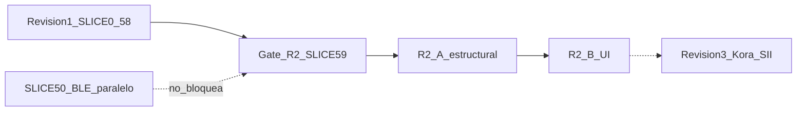

# 20 — Plan revisión 2 (Atria POS)

**Estado:** plan documental — **Gate R2 pendiente**  
**Prerrequisito revisión 1:** SLICE-54 cerrado; org `atriasolutions/AtriaPOS` (DEC-046).  
**Prerrequisito código R2:** **Gate R2** (SLICE-59) antes de lógica de negocio revisión 2.  
**TDD:** [`09-estrategia-tdd.md`](09-estrategia-tdd.md) (ciclo vertical obligatorio).  
**Revisión 3:** emisión SII vía Kora — [`20b-esbozo-revision-3.md`](20b-esbozo-revision-3.md) (fuera de R2).

---

## §0 — Metadatos y relación con revisión 1

### §0.1 Repositorio y acta

| Campo | Valor |
|-------|-------|
| Repo canónico | [atriasolutions/AtriaPOS](https://github.com/atriasolutions/AtriaPOS) |
| Acta revisión 1 | [`19-revision-progreso-20251120.md`](19-revision-progreso-20251120.md) |
| Cola slices | [`10-plan-entregas.md`](10-plan-entregas.md) (SLICE-59+) |

### §0.2 Qué se congela vs qué evoluciona

| Congelado (revisión 1 operativa) | Evoluciona en revisión 2 |
|----------------------------------|---------------------------|
| Flujo venta + turno + DTE fake / cola revisión 1 | Perfil usuario, permisos, carrito |
| Núcleo offline-first, SQLite Drift | Planilla colaboradores, código vendedor |
| Marca Atria POS, BLE companion (código) | Stock, auditoría, plantilla POS (modelo) |
| SII producción / Kora emisor | UI acotada (fase R2-B) |

### §0.3 Convención de IDs

| Prefijo | Uso revisión 2 |
|---------|----------------|
| `RF-080` … `RF-089` | Requisitos nuevos (promover a doc 04 al cerrar slice) |
| `API-011` … | Contratos nuevos (promover a doc 07 al cerrar slice) |
| `SLICE-59` … `SLICE-75` | Entregas revisión 2 |
| `SC-059-xx` … | Escenarios en `test/acceptance/slice_NN_*.md` |
| `DEC-047+` | Decisiones P0 revisión 2 (slots en doc 16 al implementar) |

### §0.4 Deuda revisión 1 en paralelo

**SLICE-50** (piloto BLE evidencia SC-011-BLE-01) permanece **ABIERTO** en doc 10 y acta 19. **No bloquea** Gate R2 ni slices R2-A/B salvo hotfix BLE explícito.



---

## §1 — Norte de producto: plantilla **Atria POS**

### §1.1 Definición

**Atria POS** es la plantilla por defecto de la revisión 2: POS de mostrador para comercio de barrio y rubros afines, con roles acotados, trazabilidad de vendedor sin motor de comisiones, y menú derivado de capacidades habilitadas.

No se usa la etiqueta “barrio mínima” en documentación nueva; el nombre de producto y plantilla es **Atria POS**.

### §1.2 Mapeo roles (revisión 1 → revisión 2)

Expansión de nombres y permisos; enums técnicos pueden conservar `dueno` / `supervisor` / `cajero` hasta migración explícita (DEC).

| Rol revisión 1 | Rol lógico Atria POS (UI/docs) |
|----------------|--------------------------------|
| `dueno` | Jefe de tienda |
| `supervisor` | Jefe de turno |
| `cajero` | Cajero |

### §1.3 Funciones: correo de producto → Atria POS

| Función | Atria POS (R2) | Backlog plantilla / R3 |
|---------|----------------|------------------------|
| Venta, turno, cierre caja | Sí (revisión 1 + mejoras) | — |
| Editar carrito (todos los perfiles de venta) | Sí SLICE-62/71 | — |
| Usuario: id, nombre, apellido, RUT, username, PIN | Sí SLICE-60 | Huellero opcional → backlog |
| Username/PIN sin `ñ` | Sí SLICE-60 | — |
| Planilla colaboradores + código vendedor en venta | Sí (trazabilidad) | Motor comisiones / antigüedad |
| Ingreso existencias + guía/lote | Sí SLICE-65 | — |
| Auditoría por fechas y categorías | Sí SLICE-66 | Transbank detallado → complemento |
| Cierre inventario (cruce) | Sí SLICE-68 | — |
| Stock “por acabarse” / más vendidos 30 días | Sí SLICE-67 | — |
| Modelo plantilla (flags/menú) | Sí SLICE-69 (solo Atria POS activa) | Plantillas rubro + custom |
| Admin sistema / cadena / comisiones cadena | No | Plantilla enterprise |
| Emisión boletas SII productiva vía Kora | No | **Revisión 3** |
| Pruebas integración servicios de pago | No | Complemento / plantilla |

---

## §2 — Fuera de alcance (revisión 2)

- Emisión boletas al **SII** en producción vía **Kora** → revisión 3 ([`14-nucleo-y-complementos-kora.md`](14-nucleo-y-complementos-kora.md), [`20b-esbozo-revision-3.md`](20b-esbozo-revision-3.md)).
- Huellero como autenticación principal.
- Administrador de sistema (multi-cadena) y ajuste de comisiones por antigüedad de contrato.
- Motor de liquidación de comisiones por período.
- Personalización multi-rubro completa (más allá del **modelo** de plantilla y menú Atria POS).
- Reescritura del adaptador DTE revisión 1 salvo compatibilidad requerida por datos piloto.

---

## §3 — Gate R2 (antes del primer slice de código R2)

**Slice:** SLICE-59. **Entregable:** checklist cerrado + este documento vigente + acceptance [`slice_59_gate_revision_2.md`](../test/acceptance/slice_59_gate_revision_2.md).

### §3.1 Checklist Gate R2

| ID | Criterio | Estado |
|----|----------|--------|
| G2-01 | Plantilla Atria POS acotada (§1) confirmada por producto | ✅ |
| G2-02 | Fuera de alcance R2/R3 explicitado (§2, doc 20b) | ✅ |
| G2-03 | Política credenciales: username/PIN sin `ñ`; nombre/apellido con español Chile | ✅ |
| G2-04 | Herencia de permisos documentada (§4, epic E2; DEC pendiente SLICE-61) | ✅ |
| G2-05 | SLICE-50 declarado paralelo (§0.4) | ✅ |
| G2-06 | Fila SLICE-59 en doc 10 = autorizado para `feat/slice-60-*` | ✅ |
| G2-07 | Equipo leyó doc 20 + doc 09 | ✅ |

### §3.2 Criterio de hecho

Gate R2 **cerrado** cuando G2-01…G2-07 están ✅ y commit documental/evidencia SLICE-59 en `main`.

---

## §4 — Fase R2-A (estructural / sistema)

Un **slice activo** a la vez. Sin UI de producto nueva salvo tests; pantallas en R2-B.

| Epic | SLICE | Resumen | RF prop. | Pruebas primero |
|------|-------|---------|----------|-----------------|
| E0 | **59** | Gate R2 | — | acceptance gate |
| E1 | **60** | Perfil usuario: nombre, apellido, RUT, username; PIN/username sin `ñ` | RF-080 | dominio + auth API |
| E2 | **61** | Permisos heredados; matriz `Permission` / roles Atria POS | RF-081 | `auth_policy_test` |
| E3 | **62** | Carrito: editar cantidad y eliminar línea; todos los roles con `Permission.vender` | RF-082 | application + `SaleService` |
| E4 | **63** | Planilla colaboradores (CRUD; código vendedor) | RF-083 | dominio + persistencia |
| E4 | **64** | `sellerCode` en checkout (trazabilidad; sin comisiones) | RF-084 | `confirm_checkout_test` |
| E5 | **65** | Ingreso existencias con referencia guía/lote; solo SKU existente | RF-085 | inventario + auditoría |
| E6 | **66** | Auditoría por rango de fechas y categorías (ventas, inventario, usuarios) | RF-086 | extiende RF-070 |
| E7 | **67** | Consulta stock: bajo mínimo + top ventas 30 días | RF-087 | query/report |
| E8 | **68** | Cierre inventario: cruce existencias, ventas, recuento manual | RF-088 | caso de uso nuevo |
| E9 | **69** | Modelo plantilla POS (feature flags); default **Atria POS** | RF-089 | dominio config |

### §4.1 Notas de implementación

- **E3:** Hoy `SaleService.updateLine` / `removeLine` no aplican `AuthPolicy`; alinear con política de carrito y auditar si aplica.
- **E4:** Código vendedor en **planilla**, no en usuario de caja (no todos los vendedores operan POS).
- **E5–E8:** Pagos tarjeta en auditoría pueden usar categoría stub hasta complemento Transbank.
- **E9:** Prepara R2-B menú (SLICE-75); no activar plantillas enterprise en R2.

Migraciones SQLite: documentar en [`08b-esquema-sqlite-v1.md`](08b-esquema-sqlite-v1.md) § R2 al cerrar cada epic con Drift.

---

## §5 — Fase R2-B (UI breve)

**Regla:** ningún slice R2-B sin tests API/casos de uso verdes del epic R2-A correspondiente.

| Epic UI | SLICE | Pantallas / smoke |
|---------|-------|-------------------|
| U1 | **70** | Alta/edición usuario (campos R2) — `SC-070-UI` patrón |
| U2 | **71** | Vender: editar/eliminar líneas carrito (todos roles de venta) |
| U3 | **72** | Código vendedor antes de checkout |
| U4 | **73** | Stock insights + ingreso con guía/lote |
| U5 | **74** | Auditoría ampliada y cierre inventario (jefe de turno) |
| U6 | **75** | Menú según plantilla Atria POS |

DoD UI: tests widget/integration en `apps/pos_app` con IDs `SC-NNN-UI-01` en acceptance.

---

## §6 — TDD y definición de hecho (revisión 2)

```text
1. Escenario en test/acceptance/slice_NN_*.md (Gherkin)
2. Test de comportamiento en packages/core/test/ (adapters si Drift)
3. Actualizar docs/07 (y 04) si cambia contrato — mismo PR que el slice
4. R2-B: UI + smoke
5. ci-local.ps1 verde
6. Commit feat(slice-N): … (slice-cierre-commit.mdc)
```

No “horizontal dump” de tests; un escenario → implementación mínima → refactor (doc 09).

---

## §7 — Roadmap revisión 3 (puntero)

Cierre revisión 2 con acta actualizada (§11 futuro en acta 19 o documento hermano).  
Contenido fiscal Kora: [`20b-esbozo-revision-3.md`](20b-esbozo-revision-3.md).

---

## §8 — Riesgos y dependencias

| Riesgo | Severidad | Mitigación |
|--------|-----------|------------|
| Tensión doc 14 (DTE núcleo) vs R3 Kora | Media | DEC en R3; no mezclar en R2 |
| Migración SQLite tiendas piloto | Media | DEC migración por epic; backup runbook |
| SLICE-50 mezclado en R2 | Baja | Solo hotfix BLE etiquetado |
| Scope creep comisiones/huellero | Media | §1.3 tabla in/out |

---

## Anexo A — Jerarquía correo → Atria POS / backlog

| Nivel correo | Atria POS R2 | Backlog |
|--------------|--------------|---------|
| Administrador sistema | — | Enterprise + plantillas multi-tienda |
| Jefe de tienda | ≈ `dueno` ampliado (usuarios, catálogo) | Comisiones cadena |
| Jefe de turno | ≈ `supervisor` (inventario, auditoría) | — |
| Cajero | `cajero` | — |

---

## Anexo B — Tabla SLICE-59 … SLICE-75

| SLICE | Fase | Título corto |
|-------|------|--------------|
| 59 | R2-A / Gate | Gate R2 + plan revisión 2 |
| 60 | R2-A | Perfil usuario y credenciales |
| 61 | R2-A | Permisos heredados |
| 62 | R2-A | Carrito editable todos roles venta |
| 63 | R2-A | Planilla colaboradores |
| 64 | R2-A | Código vendedor en venta |
| 65 | R2-A | Ingreso existencias + guía/lote |
| 66 | R2-A | Auditoría por rango/categoría |
| 67 | R2-A | Stock insights |
| 68 | R2-A | Cierre inventario |
| 69 | R2-A | Modelo plantilla Atria POS |
| 70 | R2-B | UI usuarios |
| 71 | R2-B | UI carrito |
| 72 | R2-B | UI código vendedor |
| 73 | R2-B | UI stock / ingreso |
| 74 | R2-B | UI auditoría / cierre inventario |
| 75 | R2-B | UI menú plantilla |

Detalle operativo duplicado en [`10-plan-entregas.md`](10-plan-entregas.md) § Revisión 2.

---

## Anexo C — Insumos de producto

Ideas de correo y políticas (credenciales, R2-A/R2-B, R3) incorporadas en §§1–2 y §4; no se versiona borrador externo del agente en el repo.