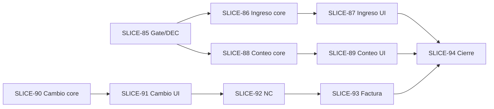

# 21 — Revisión siguiente · Bloque A — Operación y productos (scanner-first)

**Estado:** **cerrada** (2026-11-25) — **Gate R4-A cerrado** ([`23-gate-r4-a-respuestas.md`](23-gate-r4-a-respuestas.md)); slices **85–94** ✅; acceptance cierre [`slice_94_cierre_bloque_a.md`](../test/acceptance/slice_94_cierre_bloque_a.md).  
**Par de documentos:** Bloque B (companion web) en [`22-plan-companion-web.md`](22-plan-companion-web.md) — **no se planifica por slices hasta cerrar este plan**.  
**Prerrequisitos:** revisión 2 ✅ (SLICE-77); revisión intermedia ✅ incl. SLICE-84 (2026-11-24).

---

## Objetivo

Modernizar el **manejo de productos y stock en tienda** con flujos **scanner-first** (ingreso y inventario), sobre la **base de datos interna** del POS (local-first), más **cambio de producto** en mostrador y extensión fiscal **nota de crédito** y **factura**, sin integración Transbank conectada.

## Límites acordados

| Incluye | Excluye |
|---------|---------|
| Escaneo línea a línea (ingreso y conteo inventario) | **Transbank** como integración de pago en vivo / conciliación automática |
| Sesiones de escaneo → movimientos `RECEPCION` / conteo (RF-085, RF-088) | Companion **web** (Bloque B) |
| Cambio de producto con trazabilidad stock + venta/DTE según reglas | Export masivo solo código de barras (backlog previo) |
| NC y factura en núcleo DTE + cola; piloto SII según DEC | Edición masiva de catálogo fuera de flujos definidos |

**Excepción deseable (posterior):** registro de pago por **voucher** Transbank **sin sincronizar** — slice opcional solo si el cliente lo confirma en Gate R4-A (no bloquea 85–94).

**Relación `20b`:** emisión SII vía Kora sigue esbozo aparte; los slices 92–93 asumen primero **núcleo POS** (`DteGateway`) y exigen **DEC** en doc 16 si coexisten con Kora.

---

## Gate R4-A (antes de código)

1. Confirmar esta tabla de slices (o ajustar numeración/alcance con el cliente).  
2. Decidir regla de escaneo: **un bip = una unidad** vs **bip + cantidad** para el mismo SKU.  
3. Cambio de producto: ¿siempre NC automática o solo sobre ventas con boleta?  
4. Ambiente SII para NC/factura: fake / cert / live (igual política que RF-050 piloto).  
5. Firmar alcance Transbank (excluido salvo voucher manual opcional).

**DoD del gate:** acta breve en §13 de [`19-revision-progreso-20251120.md`](19-revision-progreso-20251120.md) + filas SLICE-85…94 en [`10-plan-entregas.md`](10-plan-entregas.md) marcadas **planificado**.

---

## Orden de slices (Bloque A)

Cada slice: TDD vertical, acceptance en `test/acceptance/`, fila en `10`, `CHANGELOG` al cierre.

| # | Slice | Capa | Entregable | RF / notas | DoD resumido |
|---|-------|------|------------|------------|--------------|
| 85 | SLICE-85 | Docs + core | Gate R4-A y contrato sesión escaneo | RF-094 (nuevo), amend 07 | DEC escaneo operación; API borrador `ScanSession` / confirmación ingreso; tests contrato |
| 86 | SLICE-86 | Core | Ingreso stock desde sesión escaneada | RF-085 amend | `confirmStockReceiptScan`: valida productos existentes, guía/lote, persiste `RECEPCION`; SC-086-* API |
| 87 | SLICE-87 | App | UI ingreso por escaneo | RF-085 | Pantalla scanner-first; BLE / teclado / campo manual; SC-086-UI-* |
| 88 | SLICE-88 | Core | Conteo inventario por escaneo | RF-088 amend | Sesión conteo vs sistema; cruce con `closeInventory` o borrador parcial; SC-088-SCAN-* |
| 89 | SLICE-89 | App | UI inventario por escaneo | RF-088 | Mismo canal escaneo que 87; supervisor/jefe turno; SC-088-SCAN-UI-* |
| 90 | SLICE-90 | Core | Cambio de producto (dominio) | RF-095 (nuevo) | Reglas stock, vínculo venta original, permisos; sin UI aún |
| 91 | SLICE-91 | App | UI cambio en mostrador | RF-095 | Flujo cajero/supervisor; keys e2e; integración opcional NC |
| 92 | SLICE-92 | Core + adapters | Nota de crédito | RF-050 amend, RF-096 | Tipo DTE NC; cola; fake + cert paths; SC-092-* |
| 93 | SLICE-93 | Core + app | Factura electrónica | RF-097 | Emisión factura + datos receptor; UI mínima; SC-093-* |
| 94 | SLICE-94 | Cierre | Cierre Bloque A | — | Acceptance bloque; `ci-local`; doc 04/12b; acta §13; **commit** `feat(slice-94): cierre revision operacion productos` |

**Deuda paralela (sin bloqueo):** SLICE-50 piloto BLE hardware — mejora canal escaneo pero no prerequisito de 86–87 si existe entrada manual/campo código.

---

## Dependencias técnicas [INFERIDO]

- Reutilizar búsqueda por barcode (`RF-011`) y ingreso con guía/lote (`RF-085` / SLICE-65).  
- Inventario actual: cierre con corrección (`RF-088` / SLICE-68); slice 88–89 **añaden** modo conteo por escaneo, no reemplazan cierre sin plan de migración UI.

---

## Riesgos

| Riesgo | Mitigación |
|--------|------------|
| Códigos no registrados en ingreso | Política: rechazar bip desconocido vs atajo “crear producto” (DEC en 85) |
| NC/factura y Kora | DEC en 92; no duplicar emisor |
| Doble slice “88” en conversación | Número **SLICE-88** aquí es **nuevo** (post-84); histórico R2 SLICE-88 = cierre inventario ya entregado |

---

## Artefactos por slice

1. `test/acceptance/slice_NN_*.md`  
2. Actualizar [`04-requisitos-funcionales.md`](04-requisitos-funcionales.md) y [`07-contratos-api-publica.md`](07-contratos-api-publica.md) cuando cambie contrato.  
3. [`12b-matriz-verificacion-automatizacion.md`](12b-matriz-verificacion-automatizacion.md) por escenario SC.

---

## Confirmación

Gate R4-A cerrado 2026-11-25. Bloque A cerrado con SLICE-94 (2026-11-25). Ítems `[REVISAR]` en doc 23 permanecen ABIERTO sin bloquear cierre. **Planificación Bloque B** ([22](22-plan-companion-web.md)) habilitada; slices B aún sin abrir.