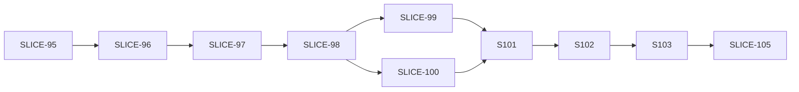

# 22 — Revisión siguiente · Bloque B — Companion web

**Estado:** **cerrado** — Bloque B (SLICE-95…105) ✅ 2026-11-25.  
**Prerrequisito:** Bloque A cerrado (SLICE-94).  
**Gate:** [23b-gate-r4-b-respuestas.md](23b-gate-r4-b-respuestas.md) · [DEC-056…058](decisiones/DEC-gate-r4-b-bloque-b.md).

---

## Objetivo

**PWA Flutter web** en Android (u otro navegador) que escanea por **cámara** y se conecta al POS por **WiFi LAN** (HTTP + WebSocket), reemplazando el companion BLE.

Flujos MVP: **Vender**, **ingreso stock** (`receiptScan`), **conteo inventario** (`countScan`).

---

## Orden de slices (Bloque B)

| # | Slice | Capa | Entregable | RF / notas | DoD resumido |
|---|-------|------|------------|------------|--------------|
| 95 | SLICE-95 | Docs | Gate R4-B | RF-098 | 23b, DEC, doc 10, amend 04/05/07 |
| 95b | SLICE-95b | Spike | Cámara HTTP Android | RNF-041 | Runbook evidencia |
| 96 | SLICE-96 | Core | Emparejamiento 1 slot | RF-098 | `PairCompanion`, SC-096-* |
| 97 | SLICE-97 | Adapters | HTTP estático + health | RF-098 | Shelf, puerto configurable |
| 98 | SLICE-98 | Core+adapters | WebSocket → ingress | RF-098 | WS scan + token |
| 99 | SLICE-99 | App POS | QR por flujo + servidor | RF-098 UI | SC-099-UI-* |
| 100 | SLICE-100 | App web | PWA pair + WS | RF-098 | `companion_web` |
| 101 | SLICE-101 | E2E | Vender | RF-098 | Scan → carrito |
| 102 | SLICE-102 | E2E | Ingreso scan | RF-085/094 | receiptScan remoto |
| 103 | SLICE-103 | E2E | Conteo scan | RF-088/094 | countScan remoto |
| 104 | SLICE-104 | Deprecación | BLE fuera default | RNF-041 | Doc + feature flag |
| 105 | SLICE-105 | Cierre | Cierre Bloque B | — | ci-local + acta §15 |

---

## Confirmación

Gate R4-B cerrado 2026-11-25. Implementación slices 96+ con TDD vertical.